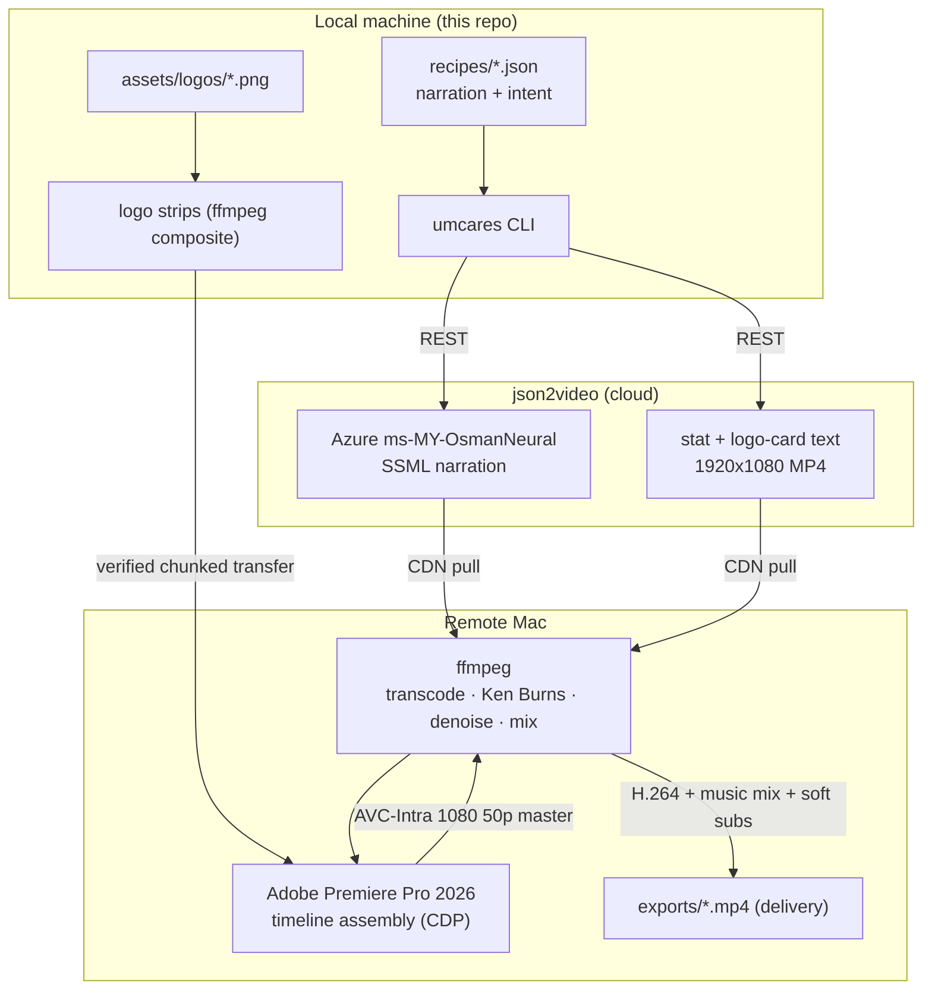
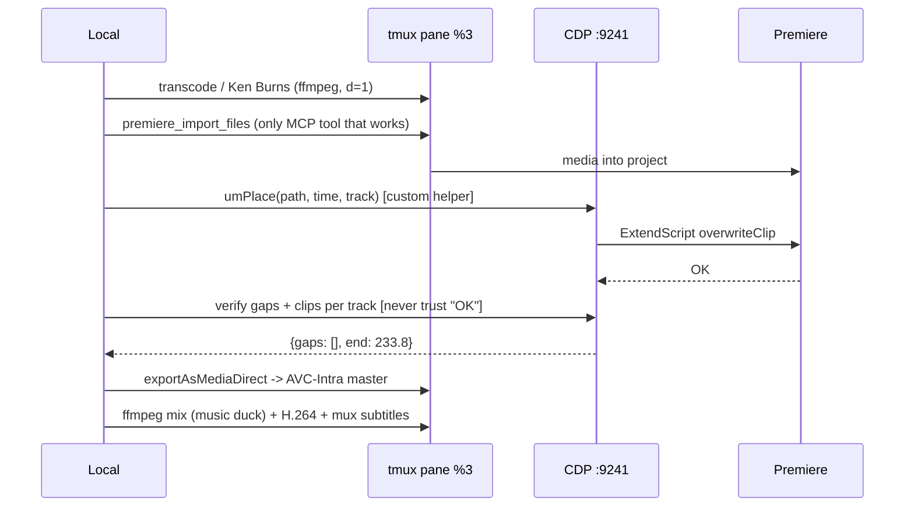

# UM Cares Report Video — RU2025-T323A

Production pipeline for the UM Cares community-programme report video
**"Amanah di Dunia Digital: Lindungi Diri dan Keluarga daripada Scam Siber"**.

Narration is AI-generated Bahasa Malaysia (Azure `ms-MY-OsmanNeural` through
json2video), statistic cards and title cards are rendered from JSON, logo
lockups are composited with ffmpeg, and the edit itself is assembled in Adobe
Premiere Pro 2026 on a **remote Mac**, driven programmatically over CDP.

| | |
|---|---|
| **Deliverable** | `UMCares_RU2025-T323A_v8.mp4` (remote `exports/`) |
| **Duration** | 233.8s (3:54) — brief allows max 4:00 |
| **Format** | 1920×1080 @ 50fps H.264, AAC stereo, ~159 MB |
| **Loudness** | −16.6 LUFS integrated, LRA 13.9 |
| **Subtitles** | soft `mov_text` track (toggleable, lang `msa`) + `.srt` sidecar |
| **Music** | `Steps_Toward_Common_Ground.mp3`, ducked under narration |
| **Logos** | real lockups on opening + closing cards (UM/MOHE/AYG, Yayasan Taqwa/ICYM/UM Press) |

Version history: v3 (207.6s, first full cut) → v4 (210.3s, ICYM/En Fikri) →
v5 (233.8s) → v6 (music bed added, −16.4 LUFS) → v7 (logo compositing fix,
En Fikri sync) → **v8** (music-ducking boundary fixed at 228s, user SRT edits
verified in-file).

---

## 1. Where things live

The repo holds **source and scripts only**. All media — footage, photos, the
Premiere project, masters — lives on the remote Mac and is gitignored.

```
DrMadihah/                          THIS REPO (source only)
├── .env                            API keys            [gitignored]
├── .env.example                    template            [tracked]
├── assets/logos/*.png              brand marks         [tracked]
├── umcares/                        the pipeline, as a CLI        [tracked]
│   ├── voice.py                    narration (Azure ms-MY SSML via json2video)
│   ├── cards.py                    stat + logo cards (json2video text + ffmpeg strip)
│   ├── srt.py                      captions from measured audio
│   ├── recipe.py                   intent -> exact timeline
│   ├── render.py                   the stage runner
│   ├── script.py                   narration round-trip + SRT drift check
│   └── …                           see umcares/README.md
├── recipes/*.json                  what to render — the source of truth [tracked]
├── tests/                          281 tests, no network         [tracked]
├── bin/umcares                     entry point (symlink onto PATH)
├── completions/_umcares            zsh completion (fzf-backed)
├── video/
│   ├── video_script.md             narration, pre-CLI draft (recipes win)
│   ├── video_edit_plan.md          the delivered cut, clip by clip
│   ├── video_subtitles.srt         hand-edited SRT (see `umcares script check`)
│   ├── video_music_brief.md        music spec with real cue sheet
│   ├── cards/                      strips + rendered cards       [gitignored]
│   └── voiceover/                  narration + auditions         [gitignored]
├── check_narration.py              whisper the VO, diff vs the recipe [tracked]
├── compare_subs.py                 whisper the delivery, diff vs cues [tracked]
└── AdobePremiereProMCP/            upstream MCP server, unused   [gitignored]

REMOTE  dsaopjfs-MacBook-Air:/Users/irpan/Projects/DrMadihah/
├── assets/
│   ├── Photos-1-001/               ORIGINAL camera media  <- do not edit from
│   ├── edit_ready/                 H.264 transcodes + Ken Burns  <- USE THIS
│   ├── vo/                         narration + cleaned testimonials
│   ├── cards/                      stat + logo cards (band slot)
│   └── music/                      Steps_Toward_Common_Ground.mp3 (bed)
├── project/DrMadihah.prproj        Premiere project (UMCares_EDIT sequence)
└── exports/                        masters (AVC-Intra 1080 50p) + delivery MP4s
```

**Voiceover route:** json2video renders Azure `ms-MY-OsmanNeural` from SSML.
Qwen-TTS (`qwen3-tts-flash`) still works — 6 auditions generated — but was
abandoned: no native Malay voice, and the deployment's `qwen-tts` model doesn't
exist. `.env` must use `JW2V`-style keys for json2video and the Qwen key as
`QWEN_API_KEY` (fallback only).

---

## 2. How the pieces fit



**Why this shape:** Premiere is good at the timeline and bad at text;
json2video is the opposite. ffmpeg does everything neither can. The remote
never receives large files from us — it pulls renders straight from the
json2video CDN; only the small logo strips travel over the tmux channel.

**Audio architecture (final mix, in ffmpeg):** music starts at t=25s (past its
soft intro; it measures −20.9 dB at 0 rising to −11.9 dB by 140s) and is
crossfaded back into itself since the 169.6s track is shorter than the 233.8s
cut. Ducking schedule: **−20 dB under narration, −18 dB under stat cards,
−25 dB under testimonials, −3 dB gain on music-only cards** (measured section
mean −18.7 dB). Ducking must hold until the narration actually ends — the
closing card at 222s vs voice through 228s is exactly the bug that produced
the loud-music complaint on v7.

---

## 3. Driving the remote

Both machines share a Tailscale tailnet (remote `dsaopjfs-macbook-air` /
`100.111.203.62`). Premiere runs on the other Mac. The CLI reaches it over
**ssh** by default (`umcares auth --setup-key` installs the key;
`umcares doctor` proves the route), and falls back to driving a **tmux pane**
when there is no key — which is how this project ran before the key existed,
and why the pane rules below still matter. Either way the timeline itself is
edited through CDP:

```
  this machine                          dsaopjfs-MacBook-Air
  ────────────                          ────────────────────

  tmux send-keys ──────────────────────► shell in tmux pane %3
  tmux pipe-pane ◄────────────────────── stdout (local log file)
        │
        │   shell commands, ffmpeg, file ops, base64 transfers
        ▼
  node cdp.js ─────────────────────────► Chrome DevTools :9241
                                              │
                                         CEP panel (Premiere)
                                              │
                                         custom helpers ──► timeline
```

- **ssh** — the default route (`--transport ssh`). Commands run directly and
  `umcares push` / `pull` move files with size verification.
- **tmux pane `%3`** — the fallback route (`--transport tmux`), a live SSH
  session in a pane. Read output via `pipe-pane` to a local file, *never*
  `capture-pane`; an SSH window resize drops the pane to a narrow width and
  capture wraps/corrupts long output.
- **CDP on port 9241** — Chrome DevTools attached to the Premiere CEP panel.
  This is what actually edits the timeline, using **custom path-based
  helpers** (see gotchas — the MCP server's place/edit tools cannot work).
  Requires `.debug` in the extension directory (see gotchas).
- **Files, on the tmux route** — anything under ~20 KB travels as base64 over
  the pane in 2000-char chunks with `wc -c` verification per chunk and
  truncate+retry on mismatch (naive chunking silently drops input). Large media
  never crosses this channel; the remote pulls it from the json2video CDN
  instead.



---

## 4. Usage

Everything below is one CLI: `umcares`. The recipe (`recipes/*.json`) says what
the video is; the CLI measures, renders and assembles it. `umcares/README.md`
is the reference — this section is the route through it.

### Setup

```bash
cp .env.example .env          # then fill in the keys
umcares doctor                # 20 checks: tools, key auth, ssh, Premiere, preset
```

`JSON2VIDEO_API_KEY` is required (it pays for renders *and* reaches the Azure
voices). `JSON2VIDEO_ENDPOINT` defaults to `https://api.json2video.com/v2/movies`.
`doctor` posts a scene-less movie to confirm the key actually authenticates —
a *present* key and a *rejected* key look identical until the first render.

### The whole cut

```bash
umcares recipe validate --file recipes/v10.json
umcares render          --file recipes/v10.json           # every stage
umcares render          --file recipes/v10.json --only voice cards
umcares render          --file recipes/v10.json --from build --dry-run
```

Stages, in order: `voice cards motion resolve import build subs export deliver
verify`. Each is resumable and skips work whose output already exists, so a
failure at `export` does not re-spend render credits on `voice`.

### Narration

Text lives in the recipe's `scenes[].narration` — **that** is the source of
truth. `video/video_script.md` is the pre-CLI draft, kept for reference.

```bash
umcares render  --file recipes/v10.json --only voice
umcares preview --voice "Amanah di Dunia Digital"    # one phrase to WAV, no credits
umcares config get voice.pitch                       # prosody lives in config
```

Voice is `ms-MY-OsmanNeural` at **natural pitch** (0%) — the +16% "young"
variants were abandoned. Pitch, rate and fillers are config
(`UMC_VOICE_PITCH`, `UMC_VOICE_RATE`, `UMC_VOICE_FILLERS`), not per-run flags,
so house style stays in one place. The recipe's `voice` block carries only the
vocabulary: `acronyms`, `english_terms`, `phoneme_terms`.

The SSML layer: `UM`, `PPR`, `ICYM` spelled out via `<say-as
interpret-as="characters">`; `scam siber` → `<lang xml:lang="en-US">scam
cyber</lang>` (English *spelling*, or the English voice mangles it); non-final
periods rewritten to commas so Azure uses continuation contours instead of a
falling terminal; per-scene `<emphasis>` only on the closing phrase of scenes
2/4/7/8. All scenes render as one movie and split on the silence between them —
one API call, unambiguous gaps.

### Cards

```bash
umcares render --file recipes/v10.json --only cards
```

Stat cards are stat tiles, not charts: for a handful of headline numbers the
number IS the chart. Values stay in primary ink and gold is reserved for the
eyebrow, so colour never carries data.

Logo cards are two-stage because neither renderer can do the whole job:
json2video lays out text but cannot read local images; ffmpeg composites the
logos but has no `drawtext` on either machine. So json2video renders the title
**with no logo band reserved in the text layout** (the band composites at
y≈862, below the text — a band at y=300 covers the title), then ffmpeg overlays
a strip built locally.

The strips carry white-band lockups. Yayasan Taqwa is 334×87 and overflows a
height-matched slot, and MOHE (474×474) / UM (500×300) are small marks in a lot
of empty canvas — so `cards.py` auto-trims surrounding whitespace, then
*contains* each mark inside its slot by width AND height rather than matching
heights. AYG is black artwork on transparency and disappears on navy: keep it
in the white band.

json2video's coordinate model, which costs credits to rediscover: `x` is
absolute from the left but text is centred inside `width`; `y` is an offset
from the VERTICAL CENTRE, so on-screen centre is `540 + y`. Anything past
y=540 silently falls off a 1080 canvas.

### Subtitles

```bash
umcares render --file recipes/v10.json --only subs     # from measured audio
umcares script check --file recipes/v10.json           # SRT vs recipe, per scene
```

Cues come from silence detection inside each scene's real WAV, placed at the
resolved timeline offsets — not from character counts, and not from a
hardcoded placement table. **Re-run whenever any scene moves**: the
pre-existing SRT was timed to an abandoned 3:45 storyboard and drifted badly.

`video/video_subtitles.srt` carries hand edits ("scam cyber" → "penipuan
cyber", 172 cues), and those edits are exactly what the next render overwrites.
`script check` compares the two sides per scene and reports `ok` / `edited`
(punctuation only) / `drift` (reworded) / `shifted` (right words, wrong window
— a stale SRT) / `missing`. To keep an edit, put it in the recipe:

```bash
umcares script export --file recipes/v10.json    # -> ./script.md
$EDITOR script.md
umcares script import --file recipes/v10.json --dry-run
umcares render        --file recipes/v10.json --from voice
```

Where the caption is *meant* to differ from the spoken word — the voice says
`seratus` because Azure reads `100` as "satu kosong kosong" — declare the pair
in `subtitles.aliases` and it stops counting as drift.

### Delivery

```bash
umcares post mix --master exports/master_v10.mxf --music … --srt … --out …
umcares verify --file recipes/v10.json          # loudness, gaps, logos, A/V sync
```

---

## 5. Gotchas

These each cost significant debugging. Read before changing anything.

**VP9 footage imports as audio-only.**
Premiere imports VP9-in-MP4 (the Google Photos download re-encode) without
error, takes the audio, and **silently drops the video** — `overwriteClip`
even returns success. 11 of 15 original clips hit this. Always transcode first
and edit from `assets/edit_ready/`:

```bash
ffprobe -v error -select_streams v:0 -show_entries stream=codec_name -of csv=p=0 in.MP4
ffmpeg -i in.MP4 -c:v libx264 -preset medium -crf 16 -pix_fmt yuv420p -r 50 \
       -c:a aac -b:a 192k -movflags +faststart out.mp4
```

**The MCP server's tools mostly do not work. Drive edits via CDP with custom
helpers.** Three stacked causes: `premiere.jsx` (1.4 MB) fails to parse —
`SyntaxError: Illegal use of reserved word 'package'` (ES3) — and defines
`mcpDispatch`, which every command routes through, so all 72 tools were dead
until a `$.global.mcpDispatch` shim was injected. `panel.js` resolves
`host/` but the files live at `src/host/` (fixed with a symlink in dist). And
the Go tool schemas were written against the never-loading file: e.g.
`premiere_place_clip` sends `source_path`/`position_seconds` while `core.jsx`
reads `projectItemIndex`/`startTime` — unknown args are dropped silently and
the call "succeeds" while placing project-item 0 at time 0 (that placed a
TikTok template in the edit once). **Only `premiere_import_files` and
`premiere_export_direct` work reliably.** Everything else:
`node cdp.js` + ExtendScript helpers over DevTools :9241.

**`createSequence` can freeze Premiere.**
`createNewSequence(name, name)` passes the sequence name where a `.sqpreset`
*path* belongs; Premiere opens a modal dialog that blocks all ExtendScript
indefinitely — that was the original "Premiere not responding". Pass a real
preset: `.../SequencePresets/HD 1080p/HD 1080p 50 fps.sqpreset`, and pass it
**directly over CDP** — the Go schema drops `preset_path`, yielding a 23.976
fps sequence. The sequence must be 50 fps to match source, or frames judder.

**json2video coordinates are not what you expect.**
With `"position": "custom"`, `x` is absolute-left **but text is centred inside
`width`**, and `y` is an **offset from vertical centre** — real centre is
`540 + y`. Anything past `y=540` silently falls off a 1080 canvas (a label at
y=580 rendered at 1120). The `→` glyph renders as a **tofu box** in the card
font — use plain text.

**json2video quota is metered per second of output.**
600s total, consumed per second of rendered output; failed renders cost
nothing. A bad key returns **HTTP 500**, not 401 — don't read it as an outage.
Design cards before rendering; there is roughly one spare full re-run.

**zoompan `d=` multiplies duration.**
`d=N` emits N frames *per input frame*. With a looped still this produced
373-second clips from 10-second targets. Use `d=1` and let `-t` set the
length.

**Neither ffmpeg build has `drawtext`** (no libfreetype), which is why all
text comes from json2video and logo work is white-strip composites.

**macOS TCC blocks the SSH session** from `~/Downloads`, `~/Documents` and
`~/Desktop` — inherited by every process it spawns, including ffmpeg and the
MCP backend, and the Full Disk Access grant for `sshd` only applies to *new*
processes (reconnect after granting; existing sessions keep the denial). Keep
all media under `~/Projects/`. AME's delivery presets live under
`~/Documents`, which is why export uses `/Applications` AVC-Intra presets
instead, and why Taildrop never lands where the backend can see it.

**Verify, don't sample.** Check gaps programmatically across the whole
timeline; sampling once missed 23.6 seconds of black because the points
straddled the gaps. Likewise check audio **per section**, not on integrated
LUFS — one build measured fine overall while the opening card sat at −39 dB
(which is also what inflated LRA to 18.4; fixed in v6 by starting the music at
t=25 and lifting card gains). And never trust `overwriteClip`'s "OK" — verify
clips per track; it happily returns success for VP9 audio-only imports.

**Overwrite leaves orphans.** `overwriteClip` landing mid-clip leaves the tail
behind as a separate clip (seen on `C0001` and `C0026`). Sweep for stray clips
after every rebuild.

**`setAudioLevel` in core.jsx is broken.** It writes to `properties[0]`
(Bypass) instead of `properties[1]` (Level), and Premiere's Level property
takes a **normalised value, not dB**: `value = 10^((dB − 15)/20)` where 1.0 =
+15 dB (default reads 0.17782794 = −15 dB). Write your own helper via CDP;
verified by round-trip (−30 dB → 0.00562341).

**tmux is a hostile environment.** `pipe-pane -o` *toggles* — re-arming the
same flag closes the pipe. Never `send-keys` while a foreground command runs;
keys land inside ffmpeg's interactive prompt and corrupt input (a q character
in the PPM prompt area is harmless; a newline is not). Run long jobs detached
(`(nohup ... &)`), poll file growth instead of matching echoed output, and
kill stale ffmpeg processes — one from a buggy Ken Burns run burned CPU for
two hours and its old encode once raced the real one for the same filename.

**Base64-over-tmux needs per-chunk verification.** A single large `send-keys`
stalls the PTY; naive chunking silently drops input (a 20 KB JPEG arrived as
13 KB). Protocol that works: 2000-char chunks, append to file, `wc -c` the
remote file, `truncate` + resend on mismatch, verify `wc -c` matches local.
A 27 KB file crossed byte-exact with zero retries at 36 chunks.

---

## 6. Client requirements (source brief)

From UM Cares, verbatim.

### Video content

**Introduction** — must contain project title and details, UM logo, MOHE logo
and other collaborating entity logos. Logos displayed at the **beginning and
end** of the video.

**Content** — elaborate on the module functions, target community,
certifications and standards, creatively, concisely and clearly. Must contain at
least **three interview testimonials** from beneficiaries (community, industry,
government, NGO/stakeholders). Should provide revenue-generating value where
measurable. Needs a storyline based on **before and after** the project
timeline.

**Quality** — montage explanation in English or Bahasa Malaysia; clear sound or
background music; high definition.

**Duration** — not exceeding **four (4) minutes**.

### Logos

| Role | Entities |
|---|---|
| Main | UM, MOHE, AYG (collaborator) |
| Sponsors (penaja) | Yayasan Taqwa, ICYM, UM Press |

### Programme details

| | |
|---|---|
| Programme | Amanah di Dunia Digital: Lindungi Diri dan Keluarga daripada Scam Siber |
| Organiser | Pusat Jalinan Masyarakat Universiti Malaya (UMCares) |
| Grant no. | RU2025-T323A |
| Target | Anak-anak penghuni PPR sekitar Lembah Klang |
| Age | 12–17 years |
| Participants | 150 |
| Date | 15 Ogos 2026 (Sabtu), 9.00 pagi – 2.00 petang |
| Speaker | En. Mohd Firdaus Khairi (Kementerian Digital) |
| Budget | RM 25,800 |

**Research team:** Dr. Madiha Baharuddin (Ketua Projek) · Dr. Fatin Nur Majdina
binti Nordin · Prof. Madya Dr. Saaidal Razalli bin Azzuhri

### Programme run sheet

| Masa | Aktiviti |
|---|---|
| 9.00 pagi | Ketibaan & pendaftaran peserta |
| 9.30 pagi | Sarapan pagi |
| 9.45 pagi | Sesi perkongsian oleh En. Mohd Firdaus Khairi (Kementerian Digital) |
| 10.45 pagi | Rehat |
| 11.00 pagi | Latihan Dalam Kumpulan (LDK) |
| 11.45 pagi | Kuiz interaktif & games |
| 12.30 tengah hari | Penyampaian hadiah & taklimat peluang pengajian oleh En. Fikri Mohd Khay (ICYM) |
| 1.00 petang | Makan tengah hari & bersurai |

Testimonials are drawn from Google Form feedback. Montage narration is in Bahasa
Malaysia; AI voice is acceptable; subtitles and background music required.

---

## 7. Requirement coverage

| Requirement | Status |
|---|---|
| ≤ 4 minutes | 3:54 — **6 seconds of headroom**, do not extend |
| HD | 1920×1080 @ 50fps, H.264, AVC-Intra master |
| Logos at start and end | opening card UM/MOHE/AYG + closing card Yayasan Taqwa/ICYM/UM Press, real lockups |
| ≥ 3 testimonials | 2 filmed participants (cleaned audio) + Google Form data on stat cards — **see note** |
| BM narration | `ms-MY-OsmanNeural`, natural pitch, SSML flow, UM/PPR/ICYM spelled out |
| Subtitles | soft `mov_text` (`msa`) + `.srt` sidecar, 172 cues, user-edited |
| Background music | `Steps_Toward_Common_Ground.mp3`, ducked −20/−18/−25 dB, crossfaded |
| Before/after storyline | scenes 2 → 5, stat card frames it explicitly |
| Monetary value | **not covered** — no figure was measurable for this programme |

Two items are worth a decision before submission: only **two filmed
testimonials** exist against a stated minimum of three, and the **monetary
value** requirement has no supporting figure. Both are content gaps, not
production gaps.
---

## 8. Research: Vox-style motion graphics (next feature)

Goal: let a recipe produce explainer-style motion graphics (Vox and similar),
not only footage cuts plus stat cards. The recipe stays declarative; the AI
declares intent, `umcares` does the timing. Nothing below is implemented yet.

### References

| Source | What it is | Use for us |
|---|---|---|
| [Create Motion Graphics with Claude (Vox-style & More)](https://youtu.be/LiQPU7_5v68) | Zinho Automates, 17 Jul 2026. Workflow: Claude chat writes a style prompt (e.g. paper-cutout collage, halftone archival photos, annotation arrows), Claude Code takes it, splits the script into scenes, generates every shot through the **Higgsfield MCP** (paid credits) with one locked style reference, lays in voiceover and times it to the visuals. Style is swappable (Vox, cartoon, whiteboard, pixel art, etc.). Its own warning: the style puts numbers on screen, and fixing a wrong one means regenerating the shot, so pin the facts before the prompt. | The *shape* (style prompt, then scenes, then a locked style) is what we want. The *engine* (Higgsfield) is metered API generation and is not ours to adopt. |
| [RomanSlack/thought-to-text](https://github.com/RomanSlack/thought-to-text) | 20 s film remade from a viral edit. `teardown.py` (librosa, faster-whisper) extracts cuts, beats and palette; Remotion renders 14 scenes in absolute seconds from one beat map; ElevenLabs VO, SuperCollider score. Principle: *keep the timing, swap the nouns.* | Beat map as the single timing source; analysing a reference edit into a template. |
| [yihui-dev/awesome-opus5-5-videos](https://github.com/yihui-dev/awesome-opus5-5-videos) | Curated list of videos where the model wrote the animation as HTML, Canvas, SVG, GSAP or Three.js. Sections: motion graphics (58), explainers (16), 3D (14), games (12). | Prompt and style gallery. Not a pipeline. |
| [JohnHeibel/PDoomVideo](https://github.com/JohnHeibel/PDoomVideo) | Music video, one file per chapter. p5.js drawn in headless Chrome, frames written in resumable batches, ffmpeg encode. Model-written `ANIMATION_GUIDE.md` and `STORYBOARD.md` brief parallel subagents. | Resumable frame renderer; storyboard-then-subagents workflow. |
| [echris6/motion-video-kit](https://github.com/echris6/motion-video-kit) | Claude Code skill for launch commercials: HTML/GSAP plus selective Three.js, HyperFrames renderer. Includes a builder/critic review loop ("Gauntlet"), motion grammar, and scripts for frozen-time checks, loudness (`ebur128`), contact sheets and offline mix. | Closest to our shape. Critic gate and QA scripts map onto `verify.py`; motion grammar maps onto recipe presets. |
| [3b1b/manim](https://github.com/3b1b/manim) | Python animation engine (`manimgl`) for math explainers. Needs Python 3.10+, FFmpeg, OpenGL, optional LaTeX. Distinct from ManimCommunity; do not mix the two. | Candidate backend for diagrams, graphs and equations. Weak fit for Vox-style collage. |

### Decisions

- **Renders on the remote Mac's CPU.** That is why the remote exists; the
  graphics render next to Premiere and nothing is pushed back and forth.
- **json2video stays.** It keeps the Azure `ms-MY` voiceover and the existing
  stat/title cards. This feature adds nothing to it and removes nothing.
- **No new metered APIs, no image-generation API.** Higgsfield and anything
  like it are out. Motion graphics are code-rendered (HTML/GSAP via headless
  Chrome, or manim), which costs CPU time only.
- **Facts are pinned in the recipe before any render.** Stat cards already
  carry the programme's figures; a wrong number baked into a frame costs a
  re-render, and in a report video it is a credibility error.

### Open questions

- **Renderer.** Candidates: HTML/GSAP via headless Chrome (PDoomVideo,
  motion-video-kit), Remotion (React, seek-safe), manim (graphs, equations).
  Must run headless on the remote Mac; each adds an install to check in
  `doctor`.
- **Stills.** Vox collage wants cutout and halftone imagery. Without an image
  API it comes from our own photos (event stills, `kenburns`) processed with
  ffmpeg or Pillow. Confirm that looks acceptable before committing.
- **Recipe shape.** A scene or card type that names a template and parameters,
  never keyframes, so durations stay resolver-owned.
- **Verification.** Reuse frozen-time and loudness checks as render gates.

### Web app and modes (planned)

`umcares web` runs on the remote Mac and is published to the tailnet only with
`tailscale serve`, the same pattern as SekerinShotto's `receiver.py`: a stdlib
server on `127.0.0.1`, access limited to the owner's `Tailscale-User-Login`.
It is the capture, library and approval surface; it never computes a timing.

| Mode | Who authors the recipe | Notes |
|---|---|---|
| **A** | Claude Code, run by hand on the Mac | most polished; the web shows the result and approves |
| **B** | templates, no model | fast draft: slow-mo montage, speed ramps, LUT grade, beat-synced cuts, text overlay |
| **C** | `umcares draft` runs `claude -p` on **your** Mac (built; see below) | no tools, server-validated, saved for approval, never rendered; the Premiere machine has no `claude` and gets none |

Rules the web must keep:

- **Uploads are deduplicated by sha256.** Same hash returns the existing file
  (so a retry is harmless); same name with a different hash is kept under a new
  suffix, never overwritten. A file counts as uploaded only once its hash is stored.
- **Every upload is probed and prepared** (VP9 to H.264) before it can be used.
- **Delete moves to a trash folder** and warns if a recipe still references it.
- **No mutation while a build or render is running.**
- **Recipe writes go through `recipe validate`** with a timestamped backup.
- **Storage stays under the project root**, never `~/Downloads`, `~/Documents`
  or `~/Desktop` (macOS TCC).

Social output: 9:16 (1080x1920), 30 fps, burned-in captions, 15-60 s. Reframing
16:9 footage to vertical needs subject tracking, not a centre crop.

**Music.** CapCut templates cannot be imported, so the look is recreated in
ffmpeg and librosa. A commercial song (e.g. a sad Indonesian track) in a posted
video gets muted or blocked. Export with no music, or a quiet placeholder, and add the
track in the platform's own app; otherwise use the royalty-free folder.

#### Mode C: `umcares draft`

```bash
export UMC_WEB_URL=https://<machine>.<tailnet>.ts.net/umcares      # or --url, or UMC_WEB_URL in .env
umcares draft cyberdsa "a 20 second upbeat reel for Instagram, hook first, keep the captions short"
umcares draft cyberdsa "..." --dry-run          # check and print it, save nothing
umcares draft cyberdsa "..." --no-images        # names and captions only: no pictures leave this machine
umcares draft cyberdsa "faster, and drop the third photo" --from latest   # revise the newest draft instead of starting again
umcares draft cyberdsa "add zoom cuts" --from my-recipe                  # ... or any saved recipe by name
```

It runs `claude -p` **on the machine you type it on** (where Claude Code is logged in), not on the Premiere machine, which has
no `claude` and no Node and gets neither. It reads the project's catalog, captions and the recipe brief from the web app,
fetches up to 12 thumbnails (one request per folder, small JPEGs), and calls Claude **once with every tool switched off**
(`--tools ""`, no session saved, a spending cap): it can only answer. The answer is checked by the web app's own dry run, the
same validation a hand-written recipe gets; if it has problems, Claude is shown them **once** and corrects. The result is
saved as `claude-draft-<time>` under *Saved recipes* and is **never rendered**: open the page, look at the plan, press Make.

- **Privacy:** the thumbnails (photos of people) and captions go to Anthropic through your Claude Code login. `--no-images`
  sends only names and captions.
- **Cost and speed:** one call. Measured on the 9-photo CyberDSA project: about 90 s end to end, most of it fetching
  thumbnails over the slow link; the model call itself is a few seconds to tens of seconds. Claude Code reports a notional
  per-call cost (about $0.03 for a small image test); on a subscription it counts against your limits. `--budget` caps it.
- **What it is good and bad at:** it picks and orders pictures, writes short captions and chooses a look, and can drop clips.
  It does not hear or watch motion, so it does not check beats or speech, and it can overshoot the length you asked for
  (it drafted 24 s for "about 20"; the plan shows the real total, so read it). It may also pick fields the brief offers that
  you did not mean, such as a tempo (`music.bpm`) it guessed; edit the recipe or ask again.
- Exit code 2 means a refusal or a clear error (no project, nothing to draw from, unreachable web app, two answers that
  failed the checker), never a half-saved recipe.

#### Choosing the project: `--project` and the refuse rule

The pipeline commands act on one folder on the remote (`UMC_REMOTE_ROOT`, the original DrMadihah project). With the web app
creating more projects there, a build run against the wrong one could clear a finished edit. So:

```bash
umcares --project cyberdsa premiere build ...   # act on that project's folder on the remote
umcares premiere build ...                      # refused (exit 2) while 2+ projects exist: "say which with --project"
umcares premiere status                         # read-only commands never need it
```

- `--project SLUG` goes **before** the command and is the project's folder name (`cyberdsa`, `dormathon`, `drmadihah`),
  **not** the `.prproj` that `premiere --project` takes; both can be given.
- Commands that **write or build** are refused without it once more than one project exists: `premiere`
  (build, import, sequence, open, export), `media` (prepare, kenburns, denoise, extract-audio), `post` (mix, export,
  import), `render`, `init`, `ingest`. With one project (or none) nothing changes.
- The project list is read from the remote, using the deployed web app's code, so this needs `umcares web deploy` once.
  Without it a write command goes ahead with a warning (so the old single-project workflow keeps working), and
  `--project` itself fails and says why.
- A project made by the web has the web's folders, not the Premiere pipeline's tree: run `umcares --project SLUG init`
  first. (`init` still also makes the local mirror folders under the repo, as before; use `--remote-only` to skip them.)
- Premiere has one project open at a time, so each pipeline project gets its own `.prproj`.

#### Deploying the web app

```bash
umcares web deploy --owner <your tailscale login>   # or set UMC_WEB_OWNER
umcares web --serve                                 # once: publish on the tailnet (tailscale serve, never Funnel)
```

`deploy` pushes `__init__.py`, `layout.py`, `projects.py` and `web.py` to
`<remote-root>/web/app/umcares/`, checks them byte-for-byte, rewrites the LaunchAgent
plist only if it changed, lets launchd (re)start it, and fails unless the service
answers. It also registers the existing project folder, without moving it. It does
not publish to the tailnet by itself.

Never start the server by hand over ssh: a leftover instance keeps the port, the
restart then dies with "Address already in use", and the old server keeps answering,
which looks like a flaky proxy. `tailscale serve` mounts by path prefix, so do not
add a second mount whose name starts with `/umcares`. The first request after
publishing can fail while the HTTPS certificate is issued.

Projects live in `~/Projects/umcares-projects/<slug>/` on the remote (override with
`UMC_PROJECTS_HOME`). Creating one from the web makes the tree, `project.json`, a
README, a `.gitignore` and a git repo; the first commit uses `umcares@localhost` as
author because that machine has no git identity. The thumbnail cache lives in
`<home>/.cache`, outside every project, so it never dirties a project's repo.

#### Uploads

The project page has three buttons: choose from the library, take a photo, record a video.
Files go up in resumable chunks, two at a time, with live MB/s on the bar.

- The server's partial file length is the single truth. A chunk is accepted only at exactly
  that offset, so a lost reply or a retry never duplicates or corrupts anything, and a page
  reload resumes where it stopped. The chunk size adapts: it doubles when a chunk takes under
  4 s and halves above 15 s, between 256 KB and 4 MB.
- Same file picked twice (name, size, modified time): recognised before any bytes move.
  Same content under another name: stored once, found by sha256 when the upload completes.
  Only uploads are compared; files already in a library from before uploads existed are not hashed.
- Photos land in `assets/photos/`, videos in `assets/inbox/` (A-roll or B-roll is a judgement
  about the shot, so it is not guessed). Only photos and videos are accepted, up to 4 GB each,
  and an upload is refused if it would leave under 2 GB free on the machine.
- Nothing partial is ever listed: a file appears under its final name in one atomic rename,
  after its size is checked. Upload state lives in `<project>/.umcares/`, ignored by git
  (`.gitignore` for new projects, `.git/info/exclude` for older ones, so no tracked file changes).
- Not built yet: converting VP9 or other unsupported video to H.264 (so an iPhone `.mov` or a
  Google Photos VP9 clip is stored as sent), and the one-by-one caption pass after a bulk upload.

#### Captions (the detail pass)

Phone files arrive named like `17915543098925884857360743224657.jpg`, which tells neither you nor the AI
that writes the recipe anything. A caption ("Dr Madihah opening the session") is what lets the recipe step
tell the speaker from the crowd shot.

After an upload saves files, the page steps through **only the files that upload added**, one at a time: a
preview, a caption box, **Save & next**, **Skip (no detail)**, **Back** and **Stop for now**. Skip records
"no detail" so the file is not asked about again; Stop leaves the rest pending. The **Add details (n)**
button reopens the pass for everything still pending, and every tile has a pencil to change its caption
(for a captioned file, Skip becomes **Remove caption**). The share page's link opens the pass directly
(`?details=1`).

- Stored in `<project>/media.json`, which **git tracks** (small, and the real history of the project, unlike
  the media). Keyed by the file's sha256, so renaming a file or sorting it from the inbox into A-roll does not
  lose its caption. Only files uploaded through the web have a hash; older files in a folder are not covered.
- Three states per file: captioned, skipped, pending. A caption is one paragraph of at most 500 characters;
  a longer one is refused with a message, never silently cut.
- Saves are committed by the server after 20 s of quiet, so a whole pass is one commit
  (`media: update captions`), not one per file. A folder that is not a git repo (the original DrMadihah folder)
  still gets `media.json`, just no commit.
- Tested: the real page scripts drive the real server under node (`tests/test_details_js.py`): the full pass,
  an empty caption, a failing save, Back, Stop, editing one file, the auto-open after an upload.

#### Making a video (montage)

The **Make a video** card turns a project's photos and clips into a short video for Instagram, Reels or
TikTok, rendered by ffmpeg on the Premiere machine. It is a separate recipe kind from the narrated
UM Cares recipe (`"kind": "montage"`): music- and look-driven, no voiceover, no Premiere. It keeps the same
rule: **the person, template or model writing the recipe declares intent and never computes a timing.**
The renderer measures the real clips and works out every duration, overlap and offset, so a recipe always
renders the same video.

```json
{"kind": "montage", "title": "CyberDSA", "format": "reels", "template": "slowmo",
 "clips": [{"media": "a1b2c3d4e5f6", "caption": "Opening speech"}, {"media": "IMG_204.jpg", "hold": 3}],
 "captions": true, "title_card": {"text": "CyberDSA 2026"}, "music": null, "max_seconds": 30}
```

- **Formats:** `reels` 1080x1920 (9:16), `square` 1080x1080, `wide` 1920x1080, all 30 fps.
- **Looks (templates):** `slowmo`, `punchy`, `clean`, `melancholy`: pacing, slow motion, crossfade length, colour
  grade, vignette and grain, recreated from how they read on screen (CapCut templates cannot be imported).
  Add a look by adding a row to `TEMPLATES` in `montage.py`.
- **Pictures and clips** are referred to by `ref` (the first 12 characters of the file's hash, which survives
  renames), by filename, or by `folder/name`. A video that has been prepared for editing is used from `edit_ready/`.
  They are ordered by the time the photo was taken: the phone's capture time is stored on the file at upload.
- **Everything is composed over a blurred copy of itself**, so a portrait photo in a 9:16 frame is never cropped
  and a landscape one never loses its sides. (ffprobe does not report an EXIF-rotated photo's true shape, so
  composing the same way every time is also simpler than detecting it.) Photos get a slow zoom; clips can be slowed.
- **Sound effects** (`sfx.py`; recipe `"sfx": {"cuts": "whoosh"|"pop"|"hit", "words": "tick"|"pop", "level": -12}`, all optional; the page has "Sound
  effects" and a tick). **Synthesised by ffmpeg**, no files and no licences: a whoosh is a noise swell (it starts 0.25 s before the
  cut so its body lands on it), a pop a falling chirp, a hit a low thump, a tick a very short high click. **Cuts:** one on every cut
  but the first (on a crossfading look, the middle of the overlap). **Words:** one on every word line the kinetic look pops in (the
  same times as the picture, so on the beat when cut to a tempo) and on every countdown number in any look. `level` is in dB
  (default -12, range -30 to 0): the effects sit under the music and speech. They are mixed into the same soundtrack step as kept
  clip sound and music, **never change a timing**, and a video with no music gets a soundtrack of just the effects. Effects-only
  audio is **limited, not loudness-normalised**: normalising a few sparse effects up to -16 LUFS made them deafening, so only a mix
  with music or speech is normalised, and the judge does not hold an effects-only soundtrack to the -16 target. Tests measure
  loudness in windows around the cuts and the word pops in real renders. **Not done:** choosing a sound per cut, whooshes that
  follow a zoom, and I have not listened to any of it (levels and timing were measured, taste was not).
- **Jump cuts: cut the dead air out of talking clips** (`"tighten": "gaps"` for every video clip, or `"tighten": true|false` on one; the page tick
  "Cut the dead air out of talking clips", **off by default**). It takes the speech detector's phrases, keeps each with 0.12 s before and
  0.22 s after (so first and last words are not clipped), joins phrases a short pause apart (silences up to about 0.8 s are natural and
  stay) and cuts every longer silence, then joins what is left. The plan shows `✂ n jump cuts, x s of dead air removed`; the clip is
  shorter by that much, `hold` still caps its length, the **clip keeps its own sound** (a silent tightened talking clip is useless)
  and the music dips under the phrases on the *joined* timeline. At render time one joined file is made (picture and sound, re-encoded
  once) and kept in `<project>/.umcares/tight/` (a cache, not in git, safe to delete), after which it is an ordinary clip, so zoom,
  tempo and every look work with it. **It cannot remove a repeated take or a filler word**: it finds speech-like sound, not words,
  and speech-to-text was not built. It also treats any speech-like sound as a phrase, so loud crowd chatter keeps its silences
  short and may be kept whole. Real footage has not been judged by ear.
- **Zoom in and zoom out.** Two things, both timing-neutral. (1) A **video clip** can zoom over its whole length: `"move": "in"` or
  `"out"` (before, only photos had moves; panning and still are still photo-only). The amount is the look's zoom (at least 6%).
  (2) A recipe-level **`transition`** adds a zoom cut: `"zoom_out"` starts a piece 12% bigger and settles in 0.3 s (ease-out),
  `"zoom_in"` pushes in during the last 0.3 s, `"zoom"` does both, so a hard cut reads as zooming through. It is a time-varying
  scale-and-crop (ffmpeg `scale` with `eval=frame`), applied to photo and video pieces (kinetic included); **not** to cards, the
  paper collage's own pieces, or audiograms. The page has a "Cuts between pictures and clips" choice. Measured on a bright square:
  the settle starts at 1.12x and is back to 1.0 by the end of the piece. Limit: the picture is upscaled by up to 12% at the peak,
  so a photo is composed at double size first to keep it sharp, but a clip is a little soft for 0.3 s.
- **3D, honestly named.** Two options, both timing-neutral, photo and video pieces only (cards, the paper collage and audiograms are
  left flat), both ffmpeg's `perspective` filter. There is **no depth model**, so nothing parallaxes: a flat picture is turned in
  perspective, not rebuilt in 3D. (1) `"transition": "flip"`: each piece swings out around its vertical axis in 0.4 s and the next
  swings in, through black (the first piece is not turned in and the last is not turned out, so the video neither starts nor ends on a
  sliver). It suits hard cuts; on a crossfading look the two overlap and it reads as a mess. (2) `"depth": "card"`: each picture is an
  80% card that sways about 25 degrees in perspective (one sway per 2.4 s or the piece, whichever is longer) over a darkened, blurred
  copy of itself; it works alone or together with `flip`. The perspective filter smears edge pixels into the empty space, so the same
  turn is applied to a white mask and the two are multiplied. Measured on a bright square: 80% wide at rest, 10% narrower a quarter of
  the way into a sway, and a flip is under half width 0.05 s either side of the cut. Costs more CPU per piece than a zoom cut (two
  perspective passes per frame); not timed on the Air. The page has "3D card flip" in the cuts list and a "3D cards that sway" tick.
- **Audiogram** (`{"audiogram": "song.mp3", "image": "photo.jpg", "caption": "Dr Madihah", "start": 0, "hold": 8}`): a song or voice
  file drawn as a moving waveform (ffmpeg `showwaves`), solid in the accent colour, over the picture darkened by 30% (or on the
  look's colour if there is no `image`), with the caption under it. **Its sound is always heard** (it is added to the soundtrack
  step, at the piece's place on the timeline) and **the music dips about 14 dB under all of it**. Every look and format. It
  is never slowed: cut to a tempo it fills whole cuts and, if its audio is shorter than the cut, the sound just ends early.
  Only recipes use it for now (not the page's picture list). Lessons from real frames: (1) the first version showed the
  file name as the caption (arguments swapped), (2) `colorkey` on a coloured waveform turned the accent green, so the waveform
  is built as the alpha of a solid colour (`alphamerge`), (3) the picture path needs its range set to limited like every
  other piece, or the whole video comes out `yuvj420p`. I first blamed (2) on 4:2:0 chroma loss on hairlines; measured, a
  hairline keeps its colour just as well (97% vs 98% accent pixels), so the chunky bars are a look, not a fix. **Limit:** over a
  long silent stretch, the final `loudnorm` lifts a dipped passage of a mix that has no voice in it (a 4 s dip measured
  about 5 dB instead of 14); with the audiogram's own voice in the mix the dip relative to the voice holds.
- **Text cards: quote, announcement, countdown** (`textcards.py`; not `cards.py`, which is the json2video title/stat/logo module
  of the Premiere pipeline). A clip with no picture: give exactly one of `quote`, `announce` or `countdown` instead of `media`.
  `{"quote": "...", "by": "Dr Madihah"}` is a big opening mark, the quote wrapped and centred, then the attribution in the accent;
  `{"announce": {"title": "Hackathon CyberDSA", "date": "12 Okt 2026", "time": "9 pagi", "place": "Dewan A", "note": "Percuma"}}`
  is the title as kinetic lines then a rounded accent chip per field (with 📅 🕘 📍), arriving one after another;
  `{"countdown": 3}` is 3, 2, 1 in equal shares of the piece (so on the beat when cut to one), the 1 in the accent. They work in
  **every look**: the background is the look's colour, and the text colour follows it (white on dark, near-black on the cream
  collage; the accent is darkened to mustard as text on a light background, and the shadow is turned off there, because a
  highlighter yellow vanishes on cream and a shadow smears dark type, both seen in real frames). They take only `hold`
  (defaults: a quote 3-8 s by length, an announcement 3 s + 0.5 s per chip, a countdown 0.8 s a number), count as clips for
  `max_seconds` (so a long list drops cards from the end with a warning), and show in the plan as `quote card: ...`. They are
  not in the page's Make-a-video card yet: write them in a recipe, or let `umcares draft` or Copy-brief-for-Claude use them.
- **The `kinetic` look (kinetic type)** is built in `kinetic.py` and reuses the normal picture composition: only the text is
  different. A caption or title becomes big bold words (upper case, `HelveticaNeue-CondensedBlack`, on both Macs) that pop in
  one line after another, stacked and centred, the **last line in the accent colour** (`#ffe14d`), over a darkened picture
  with a slow punch-in and hard cuts. At most 10 words (a longer caption is cut), grouped two or three to a line so the block
  never exceeds 5 lines. **On the beat:** when the video is cut to a song or a stated tempo, the first line lands on the
  piece's first frame and the lines follow on beats, dropping to half-beats if the caption is long; off the beat they are
  spread evenly. Title and end cards use the same words on a dark card, with the subtitle fading in after the last line.
  Tests render real frames and count pixels: nothing is on screen before the first word, words arrive one at a time, the
  accent colour appears only with the last word, and nothing touches the outer 3% of the frame. **A bug the frames showed:**
  the text renderer keeps its padding free on every side, so a one-line-high canvas shrank the type to a third of the size
  asked for; the canvas is now taller by the padding and shifted back (a test fails if that is undone). The look is meant for
  short, punchy captions: a paragraph is not readable this way.
  Captions over a picture sit in the lower third of the frame (centre 68%, never below 92%), because on the real CyberDSA photos
  centred words covered people's faces; title and end cards stay centred.
- **The `collage` look (Vox style, paper cut-outs)** is built in `collage.py` with ffmpeg alone. Paper is flat cream with
  static grain (no vignette: it turns paper grey). A photo is a **cut-out card**: halftone dot screen, white border, soft
  shadow, two strips of tape, a slight tilt that alternates between pieces. A clip gets the same card, built on every
  frame. The card **wobbles in stop-motion** (tilt and position change 12 times a second and hold between, like
  hand-animated paper) and **drops in from a side** on an ease-out curve: the clip's `move` picks the side (`in` right,
  `out` left, `pan_right` from below, `pan_left` from above, `still` no slide). Captions are marker lettering
  (MarkerFelt) on a bright paper label with its own shadow; a title is marker lettering on a tilted yellow highlighter
  swipe with the subtitle right under it. It never crossfades (hard cuts). Everything is relative to the frame, so
  a draft at half size is the same picture. The halftone is a per-pixel filter, so a photo's card is built once as a
  picture and then animated; only clips pay per frame. Fonts are macOS stock; if one is missing the text module falls
  back to the system bold font.
- **Motion is eased and has a vocabulary.** A photo's camera move is one of `in` (dolly in), `out`, `pan_left`,
  `pan_right` or `still`, named per clip as `"move"` (a recipe declares intent, never a timing). Left out, neighbouring
  photos alternate through the template's own cycle so no two in a row move the same way. Every move follows a
  smoothstep curve (slow, fast, slow): a linear move reads as mechanical. Captions and title lines glide up a few
  pixels as they fade in, on an ease-out curve, and a title card gets a thin accent line in the template's colour
  between the title and the subtitle. (ffmpeg's `drawbox` evaluates a time-based size once, so the line fades in
  instead of growing.) These behaviours are pinned by pixel tests: the zoom's first and last quarter move less than its
  middle, a pan goes the right way, a caption starts lower and settles, the accent line sits between the two texts.
- **Quick draft** (`"quality": "draft"`, the **Quick draft** button): the same video at half size, without the grain and
  vignette (the slow finishing filters; the colour grade stays) and with a fast encode. **A draft has exactly the
  final's timings** (same pieces, same cuts, same length), so what you preview is what you will get; only the pixels
  are cheaper. Measured on a 6-clip, 18.5 s reel: 5.0 s against 45.7 s, and 1.8 MB against 10.8 MB. Drafts are named
  `...-draft-...` and labelled in the list. Use drafts to try looks and orderings, then press Make video.
- **On-screen text** is drawn by macOS (AppKit, via `osascript -l JavaScript`) into a transparent PNG and laid
  over with ffmpeg, because **this ffmpeg has no `drawtext` and no libass**. It supports Malay, Indonesian and
  emoji, fits the text to its box, and puts captions on a soft plate so they read over any picture. Captions sit
  clear of the bottom of a 9:16 frame, where the platform's own buttons are.
- **Music:** press **Add a song** on the project page and pick an `.mp3`, `.m4a`, `.wav` or `.aac` (it goes to `assets/music/`, never through the share sheet or the caption pass); it then appears in the Music list of the Make-a-video card. Until 13 Oct 2026 the page had no such button (only the server accepted audio), so the README claimed something the page could not do.
  It is faded and loudness-normalised to -16 LUFS. **Use royalty-free music**: a commercial song in a posted
  video gets muted or blocked. With "No music" the video is silent, so you can add a licensed track inside the
  platform's own app when you post.
- **Cut on the beat** (`"music": {"file": "...", "sync": "beat"}`, the **Cut on the beat of the music** tick): `beats.py`
  decodes the song with ffmpeg, builds a 100 Hz "got louder" curve (full band plus the kick), takes a rough tempo from
  autocorrelation and refines tempo and offset against the whole song. Every piece is then stretched or trimmed to a whole
  number of beats (the smallest count, doubling, that lasts at least 1 s: 2 beats at 120 BPM, 2 at 80) and the song starts
  on its first beat, so every cut lands on one. Cut times are whole frames, so rounding does not drift off the beat across
  a long video. A synced video uses **hard cuts** (a crossfade has no single cut moment), and a clip shorter than one cut
  is slowed to fill it (the plan says so). The plan shows the BPM.
  **Where it fails:** it assumes one steady tempo. Live or rubato playing, a song with no drums, or a very sparse
  ambient piece gives low confidence (the grid's peak-to-mean score, needs 1.5; steady synthetic tracks score 5-13, white
  noise 1.2). Then the plan keeps the template pacing and **warns that no beat was found**, rather than cutting at a
  guessed rhythm. The grid is found to about 10 ms on synthetic kicks; real music is looser, so listen to the first
  render. Results are cached in `.umcares/beats/` (first analysis of a 3-minute song is a few seconds of Python).
- **Tap along:** under the BPM box, **Tap along to the song** turns taps into a BPM: the median gap of the last 12 taps
  (so one clumsy tap does not move it), folded into 50-200 (a count of 240 becomes 120). It needs 4 taps; a pause of 2.5 s starts
  over. It fills the BPM box, which you can still edit. Tapping is more reliable than a BPM site, which can be out by a factor of two.
- **Why "Cut on the beat" can be greyed out:** it needs a song to cut to, so it stays disabled (with "pick a song in the list above
  first" beside it) until one is chosen in the Music list; choosing "No music" again clears and disables it.
- **What the boxes take:** the Music box is a **pick list** (no typing; add a song with the **Add a song** button), and the
  BPM box is a **text box that keeps only digits and a dot**. It is not a number box on purpose: a browser's number box lets
  the letter `e` in (so typing a song name leaves junk) and then refuses every digit typed after it, which looks like "I can't
  type". `tests/test_browser.py` checks this in real headless Chrome (`tests/browser.py`, standard library only; skipped
  when Chrome is not installed), the first test here that sees what a browser really does with a form.
- **Cut to a stated tempo, no audio** (`"music": {"bpm": 75}`, the **BPM** box in the page when no song is chosen): for a
  trending sound that cannot be downloaded. Pieces become whole beats from the first frame (a cut every 2 beats at 75
  BPM = 1.6 s) and the video has **no audio**; add the song in Instagram's own picker and start it on a beat at the
  first frame. How well it lines up depends on that start: about 50 ms off is hard to notice with cuts a second or more
  apart, 150 ms is not, so scrub to the beat and check. BPM comes from you (or a BPM site; sites disagree by a factor of
  two for the same song, because they count half-time or double-time, which is harmless for a cut every 2 or 4 beats but
  makes the grid land on every other beat if you pick the wrong one). A file and a bpm together are refused.
- **Start clips where people speak** (`"speech": "follow"`, the **Start video clips where people speak** tick, on by
  default in the page, off in a hand-written recipe): `speech.py` finds the stretches of a video clip where someone is
  talking, and a clip longer than its slot starts there (0.3 s early so the first word is not clipped) instead of at
  second 0. A clip with an explicit `start` is left alone; the plan shows `🗣 n s of speech` per clip. It works from the
  clip's own sound: ffmpeg decodes the speech band, loudness is judged against that clip's own quiet floor and loud
  peaks, runs are joined across breaths, and a run counts only if its loudness pulses like syllables (not a steady hum,
  not spiky percussion). No model, no cloud. **It finds speech-like sound, not words or speakers**: applause, a very
  lively crowd or busy music with vocals can pass for speech, and a quiet voice far from the microphone can be missed.
  Measured on synthesised speech: phrase edges within about 0.1-0.3 s, steady noise and a noise bed ignored, drums and
  hi-hats ignored.
- **Keep the sound of clips where people speak** (`"clip_sound": "speech"`, a tick in the page, on by default there): a
  video clip whose excerpt holds at least 0.5 s of speech keeps its own sound; every other clip stays muted, so crowd
  noise and wind do not leak in. The music (if any) dips about 14 dB under each phrase, ramping down 0.25 s before it and
  back up 0.4 s after, so there is no click. Phrases a breath apart share one dip. The soundtrack is built in a separate
  step (the kept clips' audio placed on the timeline, slowed with `atempo` if the clip is slowed, a 30 ms fade at each
  cut, mixed with the music, loudness-normalised to -16 LUFS) and the final encode takes it as-is. Tests measure the dip
  on a constant tone: about 14 dB down inside the window, back to full level after. **Limits:** it keeps what the
  detector calls speech (see above), so a clip it mislabels will have its crowd noise kept and the music ducked for
  nothing; and there is no per-clip override yet.
- **Output** lands in `exports/` (not in git) with a `.json` sidecar holding the recipe and the resolved plan.
  It is written hidden and moved into place only after its size and length are checked. Rendering is low priority,
  cancellable, and **never runs at the same time as a prepare job** (they share one lock, because the machine is
  running Premiere). Output is limited-range `yuv420p`, tagged bt709.

**The three ways to author a recipe**, all producing the same file:

| Mode | How |
|---|---|
| B: templates | pick a look, tick and reorder the pictures, press Make video (or Preview plan first) |
| A: Claude by hand | **Copy brief for Claude** puts your files, their captions and the recipe format on the clipboard; paste it to Claude, then save what it writes as a recipe (Save recipe, or drop a `*.montage.json` into `recipes/`) and press Make |
| C: `claude -p` on the machine | not built yet |

A recipe is validated against the project and **every problem is returned at once, each with its path**
(`clips[2].media: no image/video file matches 'IMG_9'`), so a model can fix them all in one go. Saved recipes
live in `recipes/*.montage.json`, are committed to git, and turn "needs fixing" in the card if their media is later
deleted. A video limited by `max_seconds` drops clips from the end and says so; if the cards plus one clip are
already too long it says that too, instead of silently exceeding the limit.

Design notes behind the polish (from material saved in SekerinShotto): movement needs written rules and easing,
not just "a zoom"; a camera vocabulary (dolly in, pan, static) is what a model can name; a short post wants a
hook in the first seconds, one idea per shot, calm shots between busy ones, and a clear last beat (the brief for
Claude carries this advice); and typography wants hierarchy, alignment and whitespace.

Not built yet: beat-synced cuts, narration, mode C, and deleting an export from the page.

#### Preparing videos for editing

A phone clip is rarely edit-ready even when it is H.264. Variable frame rate drifts audio against
picture in Premiere, a rotation flag is not the same as upright pixels, full-range colour (`yuvj420p`)
shifts, and a `moov` atom at the end of the file slows opening. The **Prepare videos for editing** card
lists the uploaded videos, says in words what each needs, and makes an edit-ready copy in `edit_ready/`
(the only folder Premiere imports from). The original is never touched, and an existing file is never
overwritten.

Each clip is probed and gets the least work that makes it safe:

| Plan | When | What |
|---|---|---|
| copy | already conformant | an instant APFS clone: no re-encode and no extra disk |
| remux | picture fine, audio (not AAC 48 kHz) or layout (not faststart) is not | rewrite the container, no re-encode |
| reencode | anything wrong with the picture | libx264 CRF 16 (the project's existing setting), constant frame rate, rotation applied, limited-range yuv420p, AAC 192k 48 kHz stereo, faststart |

- **The judge: checking videos you choose** (`judge.py`). **Nothing is judged unless you pick it**: tick videos in the list and press
  **Check selected**, or press **Check** on one (page), or `umcares judge PROJECT NAME [NAME ...]` / `--all` (CLI; exit code 0 =
  all pass, 1 = some warn, 2 = some fail or could not be checked). It gives a **pass / warn / fail** with reasons, never a score:
  a number like "7/10" would be false confidence. Tap a result to see which checks passed and which did not. What it measures:
  **format** (size, frame rate, H.264, `yuv420p` and not full-range `yuvj420p`, length against the video's own plan and the
  `max_seconds` limit, audio present exactly when the plan wanted it, audio as long as the picture, video bits per pixel: too thin
  looks soft, too heavy is slow to move), **sound** (integrated loudness against the -16 LUFS target: -19 to -13 is fine, to
  -23/-10 a warning, beyond that a failure; true peak above -1 dBTP warns, above 0 fails; a soundtrack under -40 LUFS is silent;
  a silent gap of 1.5 s or more under a song), **picture** (black frames where a photo or clip should be, a clip that sits
  frozen 1.5 s or more; text cards are allowed to be dark and still), and **the plan** (every warning it carried; on a tempo, every
  cut within one frame of the beat grid). It uses ffprobe and two light ffmpeg passes, a few seconds per minute of video, no model
  and no network; the report is kept beside the video as `<name>.judge.json` and judged again only if the file changed or you
  press **Check again** / `--force`. Videos without a sidecar plan are judged on what can be measured. **It cannot judge**
  whether a video is good, its pacing, captions that fit, or whether the beat feels right: those need a person (a Claude pass over
  a contact sheet could find overlapping text, and is not built). Written lessons: the first loudness and bitrate checks measured
  the wrong thing (the whole file instead of the video stream), and `freezedetect`'s start and end lines run across cuts and pair
  wrongly in a whole file, so each video clip is analysed by itself; a freeze test fixture must change LUMA, because a hue
  rotation counts as frozen.
- **Download to this phone** (`downloader.js`): each finished video has a **Download to this phone** button, and by default a
  new final video that appears while the page is open starts downloading by itself (drafts and videos that were already there
  do not; a tick turns the automatic part off). It fetches the file in **128 KB pieces with Range requests, four at a time**, and keeps each piece
  in the browser's IndexedDB (by piece number, in whatever order they arrive) as it arrives, so a dropped connection only costs the pieces in flight (retried with a growing wait,
  and paused while the browser is offline), a reload or a closed tab resumes from the stored pieces (and a paused one stays
  paused), and the page shows real progress and an estimate. When the last piece arrives the file is rebuilt, its size and its
  **SHA-256** are checked against the server (`GET .../api/montage/hash?name=`, cached beside the video as `<name>.sha256`), and
  only then is **Save to phone** offered, which hands the browser the whole file under its own name; a damaged copy is thrown away
  and fetched again, a video replaced on the server restarts instead of mixing two files, a deleted one loses its phone copy.
  The stored copy stays until **Remove copy**. It asks the browser for persistent storage and for room first, and holds a
  screen wake lock while downloading. **Parallel pieces** help when each request is slow but the link has room (a test proxy that
  delays every request: 12 pieces take under half the time of one at a time) and are no help when the link itself is the limit. **On the
  real link the gain is not demonstrated:** three 5 MB videos on 16 Oct gave 74, 155 and 250 kB/s (parallel, one at a time, parallel), but the
  link itself swings about 3x between runs, so that says nothing about speed; it does show parallel downloads arrive intact (all three SHA-256
  checks passed). A single 1 MB request measured 7 kB/s a few minutes before 168 kB/s. It still mostly makes a download start earlier and
  survive drops; a normal page download pauses when the tab is closed or the phone sleeps, and Android
  Chrome's Background Fetch (keeps going with the tab closed) is **not** used yet. Tested in real headless Chrome through a proxy
  that drops connections mid-body and corrupts a piece (`tests/test_download_browser.py`).
- **A poster for each video:** next to every export is a small first-frame JPEG (`<name>.jpg`, about 15 KB), made when the
  render finishes (and on first request for an older export). The page's player shows it at once and loads only the video's
  metadata, because over a slow link (measured 7-10 kB/s) a 12 MB video is a black box for many minutes. Above 4 MB the page
  also says to download the file instead of streaming it. The poster is deleted with its video and is not listed as a video.
- **Deleting a finished video:** each video in the list has a **Delete** button (with a confirm box naming the file and its
  size). It removes that `.mp4` and its `.json` sidecar from `exports/` and nothing else, and is a real delete, not a
  trash folder, because a video is cheap to make again and the point is to give the disk back. The name must be a plain
  export file name (no path can be built from it), a video still being written (`.part`) and symlinks are refused, and
  it needs the same guard header and owner login as every other write. Saved recipes are separate and stay.
- **Variable frame rate** is detected from the actual frame timestamps (uneven gaps), not just the reported
  rate, plus rates that are not standard (an Android phone's 30.32 fps). The target is the nearest standard
  rate (24, 23.976, 25, 29.97, 30, 50, 59.94, 60). **120 and 240 are kept as they are**, so slow-motion footage
  is not flattened. A different rate can be requested (`fps` in the request, 10-240).
- **HDR clips are flagged** with a warning: they are converted to standard colour without tone mapping and
  can look flat.
- **The machine is shared with Premiere**, so jobs run **one at a time at low priority** (`nice -n 15`, 4
  threads) and can be cancelled. Progress is read from ffmpeg and shown on the card.
- **All or nothing**: output goes to a hidden `.part.mp4` and is moved into place only after its length is
  checked against the original, so `edit_ready/` never holds a half-written clip. Cancel, a failing ffmpeg,
  a wrong-length result and a full disk (it keeps 2 GB spare) all leave nothing behind.
- Unreadable files are remembered by hash and listed as unreadable, not retried on every poll.
- An edit-ready copy shows, and edits, the caption of the clip it was made from.
- Only videos uploaded through the web (which have a hash) in `inbox/` or `footage/A|B` are candidates.
  Jobs live in memory: after a service restart a half-done job is forgotten (its `.part` file is swept on the
  next job) and you press Prepare again. Already prepared clips are skipped.

#### Installing it and sharing into it

Open the page in Chrome on the phone, menu, **Install app**. It opens standalone as "umcares".
Once installed, **umcares appears in the share sheet** for photos and videos (Android Chrome only:
iOS Safari does not support sharing into a web app). Share from the gallery or camera, pick a
project, and the files upload with the same resumable uploader as the project page.

How a share travels, and why it is built this way: the phone POSTs the shared files to
`/umcares/share-target`, which the **service worker catches on the phone itself**. It parks the files
in IndexedDB and redirects to `/umcares/share?id=...`. They never cross the network in one request,
which a link that can stall for a minute would break (SekerinShotto's own README notes that failure
for a plain share). The share page shows the files, asks which project (the last one used is
preselected), and uploads. The parked files are deleted only after every one is stored; a failed file
leaves the share in place, so reopening the page or "Try the failed ones again" resumes. Shares
nobody finished within a week are forgotten.

- The worker intercepts exactly one request (`POST .../share-target`). It caches nothing and rewrites
  nothing, so pages, thumbnails and upload chunks are never stale.
- A share that reaches the server instead (the worker was not in control yet) gets a 409 asking to open
  the app once and share again; the server does not read the body.
- After a deploy that changes the manifest, uninstall and reinstall the app so Android re-registers the
  share target; it can otherwise take up to a day to refresh.
- Tested: the real worker and the real share page run under node against a fake IndexedDB and a live
  server (`tests/test_share_js.py`). Android's own share sheet and install prompt cannot be tested
  headlessly; those were checked by hand on a phone.

#### Measured link speed (9 Oct 2026)

Between the dev Mac and the Premiere Mac, with the web app live. The server is not the limit
(loopback: 1 MB in 4 ms). The path is erratic, not capped:

| When | Result |
|---|---|
| earlier, Premiere at 66-76% CPU | ssh 1 MB in 194 s (about 5 KB/s); `tailscale serve` about 7 KB/s |
| later, a 1 MB upload in 4 chunks | 72.5 s in all: 256 KB took 15 s, then 54 s, then 1.8 s; 512 KB then took 1.1 s (about 465 KB/s) |

Small packets were always fine (ping 35-74 ms, no loss, large packets pass, so not MTU), but a
plain LAN ping jittered between 5 and 112 ms. Long stalls followed by fast stretches suggest
contention on the Premiere Mac (it was CPU-saturated: Premiere, `PerfPowerServices`, load
average 3-4) or its crowded 2.4 GHz Wi-Fi (channel 13, -56 dBm), not a fixed cap; neither is
proven. This is why uploads are chunked, resumable and adaptive, and why the page makes few
requests (one thumbnail request per folder). To decide the cause: repeat the timing with
Premiere closed, then on 5 GHz or Ethernet, and from a phone on cellular.
